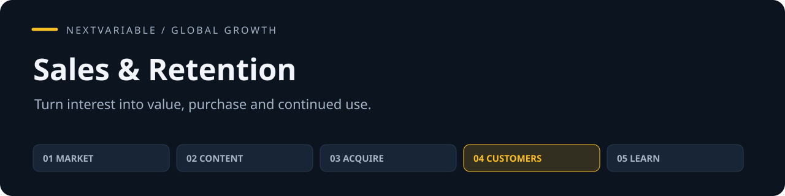

# Sales & Retention

**销售转化与客户增长 · 把已有兴趣推进到真实购买，帮助客户获得价值、持续使用、续费和扩展。**

[](https://github.com/NextVariable/global-sales-retention-skill/actions/workflows/validate.yml) [](LICENSE) [](https://agentskills.io/specification)

[快速开始](#quick-start) · [任务示例](examples/first-task.md) · [方法](#method) · [验证](#validation) · [五个 Skill 合集](https://github.com/NextVariable/global-growth-skills)

输入 **客户沟通与状态、产品和商业条件、使用或付款记录、服务能力**，得到 **下一项客户行动、跟进稿、Demo 与试点、激活及续费方案**。可以独立使用；已有项目资料或其他 Skill 的交接都能直接接入。指令以中文编写，对客产物按目标受众选择语言。

## In practice

> 先推进能用现有 CSV 流程的小品牌，确认付款人和试点范围；暂缓明天必须交付不存在功能的代理商商机。
>
> 原客户队列 GRR 为 70%、NRR 为 85%；加上新客后总 MRR 上涨 15%，仍不能证明老客户留存健康。

以上是合成任务的结果节选。[查看输入和完整任务说明 →](examples/first-task.md)

## Quick start

在你的项目目录运行，选择要安装到的客户端：

```sh
npx skills add NextVariable/global-sales-retention-skill --skill global-sales-retention
```

需要跨项目使用时加 `-g`。此安装方式需要 Node.js 22.20+；也可以直接复制技能目录。

<details>
<summary>手动安装到 Codex（Git；已有目录时停止）</summary>

```sh
git clone https://github.com/NextVariable/global-sales-retention-skill.git
cd global-sales-retention-skill
mkdir -p "$HOME/.agents/skills"
target="$HOME/.agents/skills/global-sales-retention"
if [ -e "$target" ] || [ -L "$target" ]; then
  echo "Already exists: $target"
else
  cp -R skills/global-sales-retention "$target"
fi
```

完整保留 `skills/global-sales-retention/` 内的方法、模板和许可。已有同名目录时先保存旧版及个人修改，再比较版本；不要把两份目录直接合并。其他客户端使用其配置的 Skill 目录。

</details>

重新加载客户端后调用 `$global-sales-retention`。纯 Markdown 方法，无需 Python、服务或专用密钥。

```text
使用 $global-sales-retention。
产品与当前阶段：……
这次要解决：……
已确认的能力、材料和限制：……
可投入的时间、预算与人员：……
请完成我需要的产物；未知的关键条件明确说明。
```

项目资料保存在你自己的工作目录，安装包只放通用方法。实际外发、发布、支出或客户系统操作依赖相应工具和授权。

## Method

入口只保留任务判断和必要边界，按需加载相关方法，不要求每次读完或跑完整个流程。

| 方法 | 解决什么 |
|---|---|
| [需求与推进](skills/global-sales-retention/references/discovery-and-motion.md) | 资格、购买角色、自助/销售协助和下一步 |
| [商机与交付](skills/global-sales-retention/references/deal-and-delivery.md) | 任务式 Demo、试点、异议、报价、验收与收款 |
| [激活与转化](skills/global-sales-retention/references/activation-and-conversion.md) | 真实首次价值、阻塞诊断和事件驱动跟进 |
| [留存与扩展](skills/global-sales-retention/references/retention-and-expansion.md) | 挽回原因、续费、增购及收入口径 |
| [执行与交接](skills/global-sales-retention/references/execution-and-handoff.md) | CRM/消息核验、变更范围与客户交接 |

## Validation

```sh
PYTHONDONTWRITEBYTECODE=1 python3 scripts/validate.py
```

[验证说明](validation/README.md)区分结构与记录检查、计算测试、模型任务和真实业务结果。自动检查不替代语义审阅；合成试用不能证明获客、收入或留存提升。客户端实际加载、目标用户理解和业务效果应在自己的环境验证。

## Ecosystem

[01 市场战略](https://github.com/NextVariable/global-gtm-strategy-skill) → [02 定位内容](https://github.com/NextVariable/global-growth-content-skill) → [03 发布获客](https://github.com/NextVariable/global-launch-acquisition-skill) → [04 客户增长](https://github.com/NextVariable/global-sales-retention-skill) → [05 实验复盘](https://github.com/NextVariable/global-growth-experiments-skill)

五个独立仓库，按当前问题选用。共享产品背景、证据与版本，结果可以回到前面的决策；其他四个不是安装依赖。

## Contributing

改进建议请带一个具体任务、期望结果和实际问题。开发、检查与提交方式见 [CONTRIBUTING.md](CONTRIBUTING.md)；功能问题可提交 [Issue](https://github.com/NextVariable/global-sales-retention-skill/issues/new/choose)。

## English

Move qualified interest toward purchase and lasting customer value. Work through discovery, demos, pilots, activation, renewal and expansion without confusing interest, contracts, payment and actual adoption. Install the complete skill directory and invoke `$global-sales-retention`. Instructions are Chinese-first; deliverables follow the target audience. Model and external tools are supplied by your client.

[MIT](LICENSE). 安装和再分发时保留随包许可文件。

维护与更新：[变更记录](CHANGELOG.md) · [升级与回退](docs/upgrading.md) · [安全问题反馈](SECURITY.md)。
